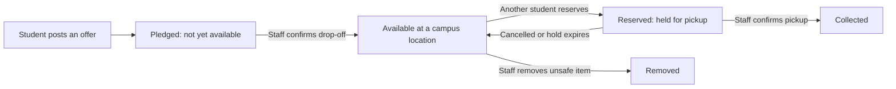

# Hackathon Submission

> **Drafts for team review.** Answers marked *Draft* were written from the project plan, MVP, and domain docs and need the team's edits before submitting. Answers 2 and 3 are Hayden's original text. Character limits are noted per prompt; the drafts were counted to fit.

## 1. Name (<128 characters)

*Draft:* Basic Needs Finder: free food and essentials for WWU students, shared through safe campus pickup points

## 2. Description & How the idea intentionally addresses barriers faced by marginalized communities. (1500 < characters)

One centralized hub for students facing food insecurity.  Bellingham and WWU specific information for the student body.

## 3. How would your idea serve a local community?  Be specific. (1500 < characters)

Around 23% (https://www.gao.gov/products/gao-24-107074) of college students face food insecurity.

Access to information is everything. Many students don’t know of the recourses available to them. Our map will make it easy for students to find all the recourses that the local community and university provides.

The ‘giveaway’ feature makes it so people can give away unwanted food or essential items to those in need.

We also provided recourses for students to apply for snap benefits.

## 4. Who will use this solution? (1200 < characters)

*Draft:* Three groups use it. Students who need help: anyone short on food, a winter coat, school supplies, or household basics, including students who would never walk into a pantry because they feel embarrassed or don't know one exists. They can browse what is available, reserve an item, and pick it up privately at a campus location without sharing a phone number or address. Students who want to give: people moving out, graduating, or with extras they would otherwise throw away. They post an offer and drop it at a campus pickup point. Campus staff and volunteers: people at the pantry, mail office, or student center who confirm drop-offs and pickups, remove unsafe food, and see what is in stock at each location. The first version is built for WWU in Bellingham, but the data model supports more campuses and locations later.

## 5. What makes your idea unique? Who else is in this space? How is your idea different? (1200 < characters)

*Draft:* Students already have campus food pantries, county food banks, Washington 211, Buy Nothing groups, and resale apps like Facebook Marketplace and OfferUp. Each solves part of the problem. Pantries have limited hours and only show stock in person. Buy Nothing groups and marketplaces mean meeting strangers and sharing contact details, and resale apps are built around selling. Basic Needs Finder combines a free peer-to-peer exchange with the reliability of a pantry: an item only appears as available after a staff member confirms it was physically dropped off at a campus location, students reserve it online and collect it there, and inventory is tracked so two people can never claim the same last item. Messaging stays inside the app, so no one has to publish a phone number. It also brings WWU and Bellingham resources, including SNAP (Basic Food in Washington) application help, into the same place students go to find free items.

## 6. Visual assets (diagrams and anything that illustrates the idea)

*Draft:* The core exchange, from offer to pickup:

Screen specifications and status badges are being designed in the ui-foundation task; add screenshots here once the app runs.

## 7. Who may want to sponsor this project

*Draft (candidates to approach, none contacted yet):* WWU Associated Students and the Dean of Students / Student Life office, which support student basic-needs programs; the Bellingham Food Bank and other Whatcom County food assistance organizations; local grocers and co-ops with food-waste or community-giving programs; Whatcom County community foundations and service clubs; and Washington higher-education basic-needs grant programs.

## 8. Feedback and improvements. How did you test and is it ADA compliant. (1000 < characters)

*Draft (update with real results before submitting):* The app is still being built, so it has not yet been user-tested or audited for accessibility. What exists today: a written test plan covering every inventory step, including the race where two students try to reserve the last item, and exactly one must win. Accessibility is a design requirement: labeled form fields, full keyboard navigation with visible focus, status shown by text and icon rather than color alone, and layouts that work on a phone. Before the demo we plan to run an automated checker (axe), test with a screen reader (VoiceOver), check color contrast, and have a few students try the offer-to-pickup flow. We will not claim ADA compliance until those checks pass.

## 9. Distribution, if your prototype were to become a project, how would you distribute it? Who is the target audience? How would you find it? (800 < characters)

*Draft:* The audience is WWU students, starting with those facing food or basic-needs insecurity. As a mobile-friendly website it needs no app store download. Students would find it through a QR code on posters at the pantry, dining halls, residence halls, and mail office, links from Canvas, orientation, and the Dean of Students' basic-needs page, and referrals from RAs and advisors. Staff at each pickup location would be onboarded first so inventory is real from day one. After a WWU pilot, the same platform could be offered to other campuses, since it already supports multiple campuses and locations.
