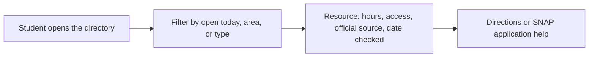
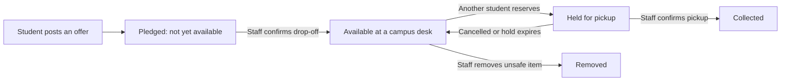

# Hackathon Submission

> **Drafts for team review.** Answers marked *Draft* were written from the project plan, MVP, and domain docs and need the team's edits before submitting. Answers 2 and 3 are Hayden's original text. Character limits are noted per prompt; the drafts were counted to fit.

## 1. Name (<128 characters)

*Draft:* Viking Table: free food and essentials for WWU students, shared through safe campus pickup points

## 2. Description & How the idea intentionally addresses barriers faced by marginalized communities. (1500 < characters)

One centralized hub for students facing food insecurity.  Bellingham and WWU specific information for the student body.

## 3. How would your idea serve a local community?  Be specific. (1500 < characters)

Around 23% (https://www.gao.gov/products/gao-24-107074) of college students face food insecurity.

Access to information is everything. Many students don’t know of the recourses available to them. Our map will make it easy for students to find all the recourses that the local community and university provides.

The ‘giveaway’ feature makes it so people can give away unwanted food or essential items to those in need.

We also provided recourses for students to apply for snap benefits.

## 4. Who will use this solution? (1200 < characters)

*Draft:* Three groups use it. Students who need food now: anyone can open the public WWU and Bellingham food directory without an account, see which pantry is open today, and get directions or SNAP application help, with no location tracking or sign-in. Students who need or have things: verified WWU students use the goods exchange to post offers and requests, reserve an item, and collect it privately at a campus pickup desk without sharing a phone number. Givers drop items off there instead of meeting strangers. Campus staff and volunteers at each pickup desk confirm drop-offs and pickups, remove unsafe or expired food, and review reported posts. The first version is built for WWU in Bellingham, and the data model supports more campuses and locations later.

## 5. What makes your idea unique? Who else is in this space? How is your idea different? (1200 < characters)

*Draft:* Students already have campus pantries, the Bellingham Food Bank, Washington 211, Buy Nothing groups, and resale apps. Each solves part of the problem, and the information is scattered. Viking Table puts both halves in one place. First, a food directory of real WWU and Bellingham resources, each with hours, access rules, and a link to its official source plus the date it was last checked, so students aren't sent to a closed pantry. Second, a free goods exchange with the reliability of a pantry: an item only shows as available after staff confirm it was physically dropped off, students reserve it and collect it at a campus desk, and the database guarantees two people can never claim the same last item. Messages stay inside the app, so no one has to publish a phone number, and food must be sealed, shelf-stable, and in date to be accepted.

## 6. Visual assets (diagrams and anything that illustrates the idea)

*Draft:* Two flows. Finding food needs no account:

Exchanging goods, from offer to pickup:

Live directory: https://owenpawl.github.io/Basic-Needs-Finder/ . Add screenshots of the directory and exchange screens before submitting.

## 7. Who may want to sponsor this project

*Draft (candidates to approach, none contacted yet):* WWU Associated Students and the Dean of Students / Student Life office, which support student basic-needs programs; the Bellingham Food Bank and other Whatcom County food assistance organizations; local grocers and co-ops with food-waste or community-giving programs; Whatcom County community foundations and service clubs; and Washington higher-education basic-needs grant programs.

## 8. Feedback and improvements. How did you test and is it ADA compliant. (1000 < characters)

*Draft (update before submitting):* Every change runs automated checks on a real PostgreSQL database: more than 40 tests covering sign-in rules, staff permissions, and every inventory step, including two students racing for the last item, repeated 50 times, where exactly one must win. A teammate fact-checked all 11 directory entries against official WWU, food bank, and state pages. During development we checked keyboard use, visible focus, and phone-width layouts. We have not yet run a formal accessibility audit (automated checker, screen reader, contrast) or tested with students, so we do not claim ADA compliance. Next steps are that audit, a short student walkthrough of the directory and exchange, and staff feedback from the pickup desks.

## 9. Distribution, if your prototype were to become a project, how would you distribute it? Who is the target audience? How would you find it? (800 < characters)

*Draft:* The audience is WWU students, starting with those facing food or basic-needs insecurity. As a mobile-friendly website it needs no app store download. Students would find it through a QR code on posters at the pantry, dining halls, residence halls, and mail office, links from Canvas, orientation, and the Dean of Students' basic-needs page, and referrals from RAs and advisors. Staff at each pickup location would be onboarded first so inventory is real from day one. After a WWU pilot, the same platform could be offered to other campuses, since it already supports multiple campuses and locations.
